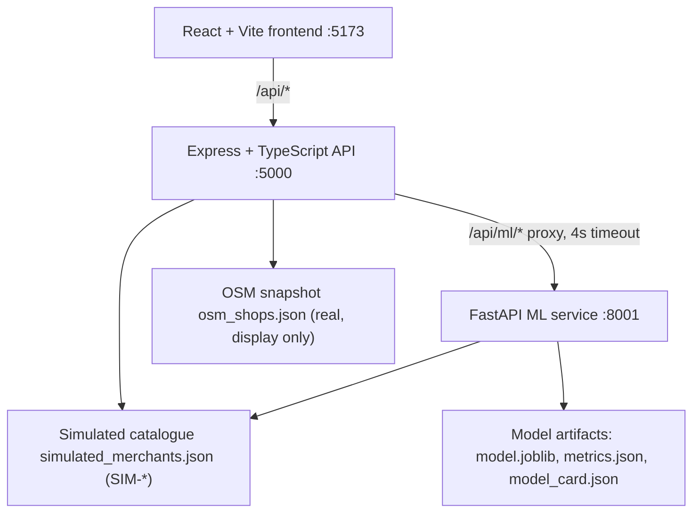

# AegisPay Sentinel

**Merchant purpose-drift detection on synthetic payment data, with real
OpenStreetMap businesses shown as display-only directory records.**

AegisPay Sentinel is a hackathon prototype for the PayU × IIM Bangalore
"Follow the Money" challenge. It monitors simulated merchant payment behaviour,
scores drift against adaptive baselines, blends rule, model and graph evidence
into a 0–100 risk score, and shows proportionate intervention tiers.

> **Data honesty notice.** Every risk score, tier, transaction, drift metric,
> fraud label, syndicate edge and intervention in this project is **synthetic**
> and attached to an anonymized `SIM-*` merchant with a **fictional name**. The
> real OpenStreetMap businesses in the directory are real identities used for
> display only — they carry no risk data anywhere in the system, and that
> separation is enforced by the type system, the API (HTTP 409) and the UI.
> See [`docs/CLAIMS.md`](docs/CLAIMS.md) for the validation status of every
> quantitative claim.

---

## Two datasets, never mixed

| | Real identities | Simulated risk layer |
| --- | --- | --- |
| Source | OpenStreetMap (Overpass), Bengaluru bbox `12.93,77.56,13.02,77.65` | `ml-service/src/data.py` + `backend/src/data/simulated_merchants.json` |
| Count | 360 shops (40 per category, incl. 40 cafés) | 14 merchants |
| Id format | `OSM-N343089650` | `SIM-0001` |
| Names | Real business names | Fictional (`Aurora Bakehouse`, `Blue Kettle Cafe`, …) |
| Risk score / tier / drift | **Never present** | Present |
| Transactions / syndicate edges | **Never present** | Present (simulated) |
| API behaviour | `GET /api/risk/merchant/<real id>` → **409** | Scored normally |
| Licence | ODbL-1.0, © OpenStreetMap contributors | Project-internal synthetic data |

Type-level enforcement:

```ts
type RealMerchantId = `OSM-${string}`;
type SimMerchantId  = `SIM-${string}`;   // disjoint from RealMerchantId
interface Transaction { merchantId: SimMerchantId; /* ... */ }
```

`RealMerchant` has no nullable risk fields at all — if a real merchant could
hold a score, the boundary would already be broken.

---

## Architecture



Three services, one repository. The ML service never reads the real OSM
directory; the Express directory never scores a real identity.

---

## Quick start (Windows PowerShell)

Prerequisites: Node.js (backend declares `@types/node` 22), Python 3.11.

```powershell
# 1. Node dependencies
npm install --prefix backend
npm install --prefix frontend

# 2. Python 3.11 environment
py -3.11 -m venv ml-service\.venv
.\ml-service\.venv\Scripts\python.exe -m pip install -r ml-service\requirements.txt
.\ml-service\.venv\Scripts\python.exe ml-service\scripts\check_env.py
.\ml-service\.venv\Scripts\python.exe -m pip check

# 3. Train the model (writes artifacts/model.joblib + metrics + model card)
.\ml-service\.venv\Scripts\python.exe ml-service\scripts\train.py

# 4. Optional: regenerate the OSM dataset (deterministic)
.\ml-service\.venv\Scripts\python.exe scripts\normalize_osm.py

# 5. Start all three services
npm run dev
```

`npm run dev` starts the ML service with the venv interpreter
(`uvicorn app.main:app --host 127.0.0.1 --port 8001`), the API on `:5000` and
the frontend on `:5173`.

Individual services:

```powershell
npm run dev:backend                     # API only
npm run dev:frontend                    # frontend only
cd ml-service
..\ml-service\.venv\Scripts\python.exe -m uvicorn app.main:app --host 127.0.0.1 --port 8001
```

Environment variables: copy `backend/.env.example` to `backend/.env`. `PORT`,
`OSM_DATA_DIR`, `ML_SERVICE_URL`, `ML_SERVICE_PORT` and an optional
`GEMINI_API_KEY` (without it the deterministic report engine is used). No secret
is required for any core feature.

---

## API surface

| Method | Path | Rule |
| --- | --- | --- |
| GET | `/api/health` | service + data-model counts |
| GET | `/api/merchants?origin=real_osm\|simulated\|all` | `dataOrigin` on every item |
| GET | `/api/merchants/:id` | real record returned without risk fields |
| POST | `/api/merchants/:id/tier` | simulated only (409 for real) |
| GET | `/api/risk/merchant/:id` | simulated only (409 for real) |
| GET | `/api/transactions?merchantId=` | simulated only (409 for real) |
| GET | `/api/transactions/stats` | simulated stream statistics |
| POST | `/api/simulator/run` | may target only simulated merchants |
| GET | `/api/syndicate/graph` | simulated nodes only |
| POST | `/api/ai/investigate/:id` | simulated only (409 for real) |
| GET | `/api/osm/status`, `/api/osm/shops` | real directory, no risk data |
| GET | `/api/ml/health` | Express proxy to FastAPI |
| GET | `/api/ml/model/info` | model card, metrics, provenance, limitations |
| GET | `/api/ml/datasets` | dataset access and licence status |
| POST | `/api/ml/score/transaction` | `SIM-*` only (422 otherwise) |
| POST | `/api/ml/score/merchant` | aggregated `SIM-*` score |

Errors always use `{ "error": { "code", "message", "details"? } }`. Full
request/response examples: [`docs/API_CONTRACT.md`](docs/API_CONTRACT.md).

---

## ML methodology

**Unit of analysis:** merchant × 3-day window over a 90-day simulated history.

1. **Data.** Deterministic simulator (seed `20261104`) produces 15,537 simulated
   transactions for 14 `SIM-*` merchants. Café amounts are partly drawn from
   `coffee_shop_transactions.csv` basket composition, using **assumed** per-item
   prices (the CSV has no amount column).
2. **Labels** come from scenario parameters (`normal` | `drift` | `syndicate`)
   plus a fixed injection day (day 55). Labels are never derived from a feature
   the model sees; `tests/test_leakage.py` fits a model on shuffled labels and
   asserts the AUC collapses to chance.
3. **Features (20):** amount statistics and round-amount ratio, night share,
   hour-of-day entropy, 10-minute burst synchronisation, Benford divergence,
   geographic dispersion and Shannon spatial entropy, payer retention and churn
   entropy, Jensen–Shannon amount drift against the category baseline, robust
   median/MAD deviations against the merchant's own adaptive baseline, and graph
   features (degree, cycle membership, shared-payer overlap, component size).
4. **Adaptive baselines:** per-merchant rolling median/MAD over the trailing 30
   days, with an explicit category fallback and `coldStart` flag when a merchant
   has fewer than 40 transactions.
5. **Graph:** payer → merchant bipartite graph plus a merchant flow graph (an
   edge means ≥3 payers paid A then B within six hours). Cycles and dense
   components feed the graph score. Built from `SIM-*` transactions only.
6. **Model:** scikit-learn `HistGradientBoostingClassifier` with isotonic
   calibration and balanced sample weights. Split by **merchant and time**:
   held-out merchants and future windows are never trained on.
7. **Risk engine:** deterministic blend of rule (0.35), model probability (0.45)
   and graph exposure (0.20) → 0–100 score, tier thresholds 25 / 55 / 80, plus
   human-readable reasons.

**Measured metrics** (from `ml-service/artifacts/metrics.json`, seed 20261104,
`tests` and `npm run build` run on 2026-11-05):

| Slice | n | Positives | Precision | Recall | F1 | ROC-AUC |
| --- | --- | --- | --- | --- | --- | --- |
| Time holdout (future windows of trained merchants) | 80 | 24 | 1.00 | 1.00 | 1.00 | 1.00 |
| Merchant holdout (unseen `SIM-*` merchants) | 120 | 12 | 1.00 | 1.00 | 1.00 | 1.00 |

> **Synthetic evaluation.** These numbers are perfect because the simulator's
> injected typologies are strongly separable by design (round amounts,
> night-time bursts, out-of-state payers, shared payer pools). They measure
> pipeline correctness on synthetic data and are **not** real-world detection
> accuracy. Real-world performance is **NOT VALIDATED**.
> The model card (`ml-service/artifacts/model_card.json`) and
> `GET /api/ml/model/info` carry the same warning.

Not used for training: AMLSim, PaySim, BankSim, MoMTSim. Their access results,
licences and schemas are recorded in
[`ml-service/docs/DATASETS.md`](ml-service/docs/DATASETS.md) and reported live by
`GET /api/ml/datasets`.

---

## OSM dataset

```powershell
.\ml-service\.venv\Scripts\python.exe scripts\normalize_osm.py
# total shops: 360   cafés: 40   copies identical: True
```

Source: OpenStreetMap (ODbL-1.0), **© OpenStreetMap contributors**. The
normalizer deduplicates by OSM type/id, requires a name and coordinates, maps
tags to nine categories (`amenity=cafe` → café, MCC 5814), and keeps a
deterministic category-balanced selection sorted by OSM type/id. Two runs
produce byte-identical output.

---

## Repository layout

```
backend/            Express + TypeScript API (real directory, SIM risk, ML proxy)
frontend/           React + Vite UI (directory tabs, SIM dashboards, ML Insights)
ml-service/         FastAPI + scikit-learn pipeline, tests, model artifacts
scripts/            normalize_osm.py (OSM source of truth), smoke.ps1
docs/               API_CONTRACT.md, CLAIMS.md, EXECUTION_LOG.md
osm_expanded_raw.json   Raw Overpass dump (ODbL-1.0)
osm_shops.json          Normalized real shops (root + backend copy, identical)
```

---

## Verification

```powershell
npm run build
.\ml-service\.venv\Scripts\python.exe ml-service\scripts\check_env.py
.\ml-service\.venv\Scripts\python.exe -m pytest ml-service\tests -q
powershell -ExecutionPolicy Bypass -File scripts\smoke.ps1
```

The smoke script starts the stack if needed, then asserts that real merchants
carry no risk data, that real ids are rejected by risk/transaction/simulator
routes, that the syndicate graph is `SIM-*` only, and that `/api/ml/*` works
through the proxy and returns 502 when the ML service is stopped.

---

## Limitations

* The risk layer is entirely synthetic; no real betting-front or fraud label was
  used, and no real merchant is accused of anything.
* Perfect synthetic metrics say nothing about production performance
  (**NOT VALIDATED**).
* No latency SLO is claimed: no benchmark was run for this build.
* `GET /api/ai/investigate/:id` returns a demo narrative. It is not
  court-admissible, not a regulatory filing, and is labelled simulated.
* AMLSim was cloned and inspected but not built (it targets Java 8; only Java 26
  and no Maven are available here).

## Licence and attribution

Application code: see repository licence. Real business data: OpenStreetMap,
**© OpenStreetMap contributors**, ODbL-1.0. External research datasets are not
committed to this repository.
